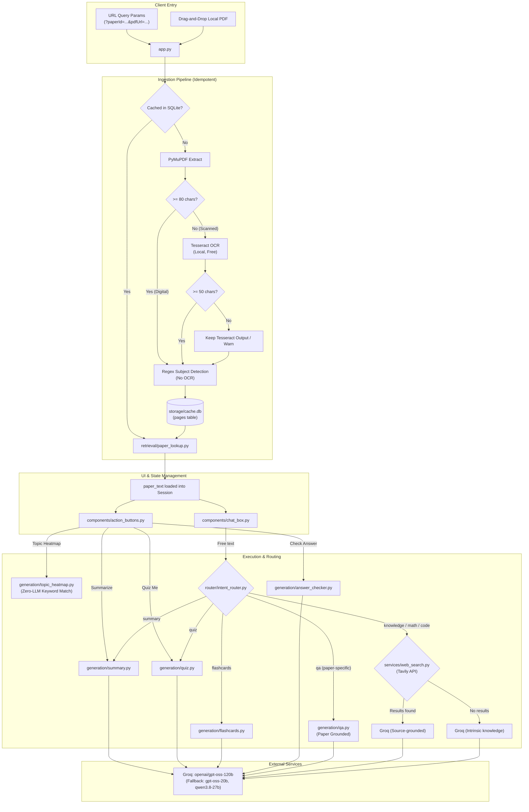

# CONTEXT FOR CLAUDE — Campus Brain (PYQ AI Study Assistant)

> **Document Purpose**: Complete, self-contained handoff specification for Claude or any subsequent AI assistant. Contains architecture, tech stack, data models, critical code snippets, active bugs, design rationale, and prioritized improvements.

---

## 1. PROJECT SUMMARY

- **Product Name**: Campus Brain (PYQ AI Study Assistant)
- **Target Audience**: University engineering students preparing for semester examinations using Previous Year Question (PYQ) papers.
- **Problem Solved**: University exam papers are distributed as unstructured, scanned, low-quality multi-page PDF bundles that mix multiple subjects and contain questions without solutions. Students waste hours manually segmenting papers, identifying high-frequency exam topics, and finding verified answers. Generic LLMs struggle because:
  1. OCR quotas and scan readability fail on raw scanned pages.
  2. PYQ papers contain only questions, so asking an LLM to "summarize answers" causes hallucinations.
- **Solution Provided**: A specialized, low-cost Streamlit web app that:
  - Ingests digital or scanned PDFs through a zero-quota pipeline (Direct text extraction $\rightarrow$ Local Tesseract OCR with adaptive preprocessing).
  - Automatically identifies subject boundaries across multi-subject bundles via regex header matching against preconfigured semester curricula.
  - Generates grounded revision intelligence: revision summaries, topic-frequency heatmaps (zero LLM calls), strict JSON multiple-choice quizzes, flashcards, deterministic answer checking, and web-augmented Q&A (Tavily + Groq).
  - Embeds directly into university portals via zero-backend `<iframe>` parameters, with a local drag-and-drop upload fallback.
- **Current Status**: **Working Prototype / Deployed on Streamlit Cloud** (`campusbrain.streamlit.app`). The local workspace has an active uncommitted working tree containing experimental RAG/predictor features and a critical syntax error in `app.py`.

---

## 2. TECH STACK

| Layer | Technology | Version | Purpose & Rationale |
|---|---|---|---|
| **Language** | Python | `3.10+` | Core application runtime. |
| **Web UI** | Streamlit | `1.38.0` | Rapid reactive UI framework with query parameter routing and session state. |
| **Styling** | Custom Vanilla CSS | — | "Stitch" dark UI theme: Google Inter typography, CSS radial dot grids, blurred aurora animations, and glassmorphism. |
| **PDF Extraction** | PyMuPDF (`fitz`) | `>=1.25.0` | Tier 1 extraction: ultra-fast, zero-cost digital text extraction and 200 DPI page-to-image rendering. |
| **Image Processing** | Pillow (`PIL`) | `>=10.4.0` | In-memory image manipulation for OCR rendering and batching. |
| **Primary OCR** | Tesseract OCR (`pytesseract`) | `>=0.3.10` | Offline, zero-quota text extraction (`--oem 3`, multi-PSM retry: 6 $\rightarrow$ 4 $\rightarrow$ 3). Deployed on Linux via `packages.txt`. |
| **Text Generation** | Groq SDK (`groq`) | `>=1.6.0` | Primary LLM text generation: `openai/gpt-oss-120b` (low-latency inference), with automatic fallback chain to `openai/gpt-oss-20b` and `qwen/qwen3.8-27b`. |
| **Web Search** | Tavily Python SDK (`tavily-python`) | `>=0.5.0` | Web search integration (`search_depth="advanced"`) grounding conceptual/theoretical student queries with live citations. |
| **Primary Storage** | SQLite (`sqlite3`) | Standard Library | Local file cache (`storage/cache.db`) indexing extracted text by `(paper_id, page_num)`. |
| **Vector DB (Untracked)** | ChromaDB (`chromadb`) | In codebase | *Untracked experimental branch*: Dense vector indexing and cosine similarity search (`storage/chroma_db/`). |
| **Embeddings (Untracked)** | SentenceTransformers | `all-MiniLM-L6-v2` | *Untracked experimental branch*: 384-dimensional dense sentence embeddings for semantic question search. |
| **Configuration** | `python-dotenv` | `1.0.1` | Local environment variable injection from `.env`. |
| **Cloud Hosting** | Streamlit Community Cloud | Ephemeral Linux | Free tier hosting configured via `.streamlit/config.toml` and Debian `packages.txt`. |

---

## 3. FOLDER STRUCTURE

```
pyq-assistant/
├── app.py                          # Streamlit application entrypoint (URL-param & drag-drop modes)
├── packages.txt                    # Debian system packages for Streamlit Cloud (tesseract-ocr)
├── requirements.txt                # Python runtime dependencies
├── README.md                       # High-level architecture and developer documentation
├── .gitignore                      # Git ignore patterns (.env, cache.db, chroma_db, venv)
├── generate_defense_pdf.py         # [Untracked] Standalone ReportLab script generating project defense guide
├── paper_predictor_orig.py         # [Untracked] Standalone prototype for Bayesian topic predictor & TF-IDF duplicate detection
│
├── .streamlit/
│   ├── config.toml                 # Streamlit server and dark theme base configurations
│   └── secrets.toml                # [Gitignored] Production secrets storage on Streamlit Cloud
│
├── data/
│   └── subjects_by_semester.json   # Static mapping of branch-semester (e.g., "IT-3") to official subjects
│
├── ingestion/
│   ├── __init__.py
│   ├── pdf_to_images.py            # Hybrid PyMuPDF extraction (checks char count >= 80) and 200 DPI image renderer
│   ├── ocr_tagger.py               # Orchestrates Tesseract OCR with multi-PSM retry, subject header regex & forward-fill
│   ├── cache_writer.py             # Ingestion manager: checks CacheStore before fetching/parsing (idempotent)
│   └── subject_reference.py        # Loads expected subjects for a given branch & semester from JSON
│
├── storage/
│   ├── __init__.py
│   ├── cache_store.py              # SQLite wrapper for 'pages' table (idempotent, skips empty text)
│   ├── cache.db                    # [Gitignored] SQLite database file
│   ├── vector_store.py             # [Untracked] ChromaDB + SentenceTransformer persistent vector store implementation
│   └── chroma_db/                  # [Gitignored] Persistent ChromaDB directory
│
├── retrieval/
│   ├── __init__.py
│   ├── paper_lookup.py             # Deterministic lookup: full paper text retrieval by paper_id
│   ├── subject_lookup.py           # Cross-paper lookup: retrieves all paper texts tagged with a subject
│   ├── multi_paper_lookup.py       # [Untracked] Chronological multi-paper retrieval for cross-year trend analysis
│   └── vector_search.py            # [Untracked] High-level semantic search wrappers over vector_store.py
│
├── generation/
│   ├── __init__.py
│   ├── qa.py                       # Two-path Q&A: Tavily web-grounded conceptual path vs. paper-grounded path
│   ├── summary.py                  # Revision summary generator (topics, mark distributions, revision checklist)
│   ├── quiz.py                     # 5-question MCQ generator with robust regex JSON parsing (_extract_json)
│   ├── flashcards.py               # 10-card exam flashcard generator (Anki-style term/definition JSON)
│   ├── topic_heatmap.py            # Zero-LLM topic frequency & mark counter using regex question splitting
│   ├── topic_ranker.py             # Cross-year topic frequency aggregator using LLM prompt
│   └── answer_checker.py           # Single-prompt exam answer evaluator (scores /10 with model answer)
│
├── router/
│   ├── __init__.py
│   └── intent_router.py            # Keyword & regex heuristics routing user chat to 5 distinct generation paths
│
├── services/
│   ├── __init__.py
│   ├── llm_client.py               # API wrappers: Groq text completion chain & model fallback handling
│   └── web_search.py               # Tavily search wrapper returning top 3 snippets with advanced search depth
│
└── components/
    ├── __init__.py
    ├── theme.py                    # CSS injector: Inter fonts, aurora animation blobs, and custom card styling
    ├── action_buttons.py           # Top action buttons (Summarize, Quiz, Heatmap, Answer Checker, Export)
    └── chat_box.py                 # Chat message renderer with custom expanders for quizzes and flashcards
```

---

## 4. ARCHITECTURE AND FLOW

### High-Level Architectural Diagram



### Main User Flows End-to-End

1. **Embedded URL-Parameter Flow (Host LMS Integration)**:
   - Host website renders `<iframe src="https://campusbrain.streamlit.app/?paperId=cs3-ds-2024&pdfUrl=https://.../paper.pdf&subject=Data+Structures&year=2024&branch=IT&semester=3">`.
   - `app.py` parses query params. If `paperId` and `pdfUrl` exist, it checks `CacheStore.is_cached(paper_id)`.
   - If not cached, `ingest_paper()` downloads the PDF to a temporary file, evaluates each page via PyMuPDF $\rightarrow$ Tesseract OCR, runs subject detection, and inserts records into SQLite `pages`.
   - Full paper text is pulled via `get_paper_text()`. Controls and chat box render immediately.

2. **Local Upload Flow**:
   - User visits bare URL without query params.
   - `app.py` displays the frosted-glass hero upload panel.
   - User drags and drops a PDF file.
   - App computes an MD5 checksum of raw bytes as `paper_id`, writes bytes to a temporary file, calls `ingest_local_paper()`, and proceeds to render controls and chat.

3. **Deterministic Heuristic Topic Heatmap (Zero LLM Costs)**:
   - User clicks "📊 Topic Heatmap".
   - `components/action_buttons.py` triggers `generate_topic_heatmap(paper_text)`.
   - `generation/topic_heatmap.py` splits the paper into questions using regex matching question numbering (`Q1`, `1.`, `a)`, etc.), evaluates each question against `TOPIC_KEYWORDS` dictionaries, extracts question marks (e.g., `[10M]`), and compiles topic frequencies.
   - Streamlit displays an instant interactive `st.bar_chart` and `st.dataframe` with zero API latency or token cost.

4. **Web-Augmented Conceptual Q&A Flow**:
   - User types: *"Explain the working of Banker's Algorithm"*.
   - `router/intent_router.py` detects keywords (`explain`, `working of`) and classifies intent as `"knowledge"`.
   - `generation/qa.py:knowledge_answer()` queries Tavily API for top 3 results (`search_depth="advanced"`).
   - If search results return, snippets are injected as `[Source 1]`, `[Source 2]` blocks into `_WEB_KNOWLEDGE_PROMPT`.
   - Groq completes the prompt using `openai/gpt-oss-120b` at `temperature=0.4` with mandatory inline citations and source URL listing.
   - If Tavily has no quota or is disabled, system gracefully falls back to `_INTRINSIC_KNOWLEDGE_PROMPT` without crashing.

---

## 5. KEY CODE

### 1. `app.py` (Streamlit Entrypoint & Secret Syncing)
**Role**: Coordinates secret synchronization, query parameters, local file uploading, paper ingestion, session flushing, and top-level UI components.  
**Dependencies**: `streamlit`, `dotenv`, `components.theme`, `ingestion.cache_writer`, `retrieval.paper_lookup`, `components.action_buttons`, `components.chat_box`.

```python
# Lines 27-58: Secret synchronization ensuring cloud st.secrets work seamlessly with os.environ
def _copy_secrets_to_env():
    """Recursively copy st.secrets into os.environ."""
    import streamlit as _st
    def _flatten(mapping, prefix=""):
        for k, v in mapping.items():
            full_key = f"{prefix}{k}" if not prefix else f"{prefix}_{k}"
            if isinstance(v, str):
                os.environ[full_key.upper()] = v
            elif hasattr(v, "items"):
                _flatten(v, prefix=full_key.upper())
    try:
        _flatten(_st.secrets)
    except Exception as _se:
        print(f"[app] Warning: could not copy st.secrets to env: {_se}")

_copy_secrets_to_env()

# Lines 163-169: Paper change isolation guard
if "messages" not in st.session_state or st.session_state.get("current_paper_id") != paper_id:
    st.session_state.messages = []
    st.session_state.current_paper_id = paper_id

# Lines 249-270: CRITICAL BUG ALERT (Orphaned syntax error currently in working directory)
# NOTICE: Lines 262-265 contain an orphaned string and closing parenthesis from an incomplete edit!
```

### 2. `services/llm_client.py` (Groq Resilience Engine)
**Role**: Provides fault-tolerant clients for Groq. Implements model fallback chains across available models.  
**Dependencies**: `groq`, `os`.

```python
# Lines 255-296: Groq generation with fallback chain across available models
def generate_text(
    prompt: str,
    model: str = "openai/gpt-oss-120b",
    temperature: float = 0.2,
    max_tokens: int = 2048,
) -> str:
    # Fallback chain using models verified on Groq free tier
    model_chain = [model]
    for fb in ["openai/gpt-oss-20b", "qwen/qwen3.8-27b"]:
        if fb not in model_chain:
            model_chain.append(fb)

    client = get_groq_client()
    for attempt_model in model_chain:
        try:
            response = client.chat.completions.create(
                model=attempt_model,
                messages=[{"role": "user", "content": prompt}],
                temperature=temperature,
                max_tokens=max_tokens,
            )
            content = response.choices[0].message.content
            if content:
                if attempt_model != model:
                    print(f"[generate_text] Used fallback model {attempt_model}")
                return content
        except Exception as e:
            print(f"[generate_text] {attempt_model} raised {type(e).__name__}: {e} — trying next model")
    return ""

### 3. `ingestion/ocr_tagger.py` (Multi-PSM OCR & Subject Forward-Filling)
**Role**: Orchestrates direct text and local Tesseract OCR with multi-PSM retry; maps subject headers using regex and forward-fills subject tags across pages.  
**Dependencies**: `pytesseract`, `PIL`, `re`.

```python
# Lazy extraction flow (Text -> Tesseract multi-PSM)
def tag_and_extract_all(
    pages: Iterable[Tuple[int, str, Optional[Image.Image]]],
    known_subjects: List[str],
) -> Tuple[List[Dict], List[str]]:
    use_tesseract = _tesseract_available()
    
    text_page_results: Dict[int, dict] = {}
    image_page_queue: List[Tuple[int, Image.Image]] = []

    # Step 1: Process text pages locally; collect scanned pages
    for i, (text, image) in enumerate(pages, start=1):
        if image is None:
            text_page_results[i] = tag_text_page(text, known_subjects, i)
        else:
            image_page_queue.append((i, image))

    # Step 2: Local Tesseract OCR (Free, no API quota) with multi-PSM retry
    image_page_results: Dict[int, dict] = {}
    for page_num, img in image_page_queue:
        if use_tesseract:
            parsed = ocr_page(img)
            image_page_results[page_num] = parsed
    # Step 4: Subject forward-fill: propagate detected subject until a new header is encountered
    results = []
    current_subject = None
    for i in range(1, len(pages) + 1):
        parsed = text_page_results.get(i) or image_page_results.get(i, {})
        if parsed.get("has_new_subject_header") and parsed.get("subject"):
            current_subject = parsed["subject"]
        results.append({
            "page_num": i,
            "subject": current_subject or "Unknown",
            "text": parsed.get("text", ""),
        })
    return results
```

### 4. `storage/cache_store.py` (SQLite Persistence)
**Role**: SQLite storage engine for extracted pages. Prevents duplicate OCR extraction across page reloads.  
**Dependencies**: `sqlite3`, `pathlib`.

```python
# Full code (84 lines)
from __future__ import annotations
import sqlite3
from pathlib import Path
from typing import Optional, List, Tuple

DB_PATH = Path(__file__).parent / "cache.db"

class CacheStore:
    def __init__(self, db_path: Path = DB_PATH):
        self.db_path = db_path
        self._init_db()

    def _connect(self):
        return sqlite3.connect(self.db_path)

    def _init_db(self):
        with self._connect() as conn:
            conn.execute(
                """
                CREATE TABLE IF NOT EXISTS pages (
                    paper_id TEXT NOT NULL,
                    page_num INTEGER NOT NULL,
                    subject TEXT,
                    year TEXT,
                    text TEXT NOT NULL,
                    PRIMARY KEY (paper_id, page_num)
                )
                """
            )
            conn.commit()

    def save_page(self, paper_id: str, page_num: int, subject: str, year: str, text: str) -> None:
        with self._connect() as conn:
            conn.execute(
                """INSERT OR REPLACE INTO pages (paper_id, page_num, subject, year, text)
                   VALUES (?, ?, ?, ?, ?)""",
                (paper_id, page_num, subject, year, text),
            )
            conn.commit()

    def is_cached(self, paper_id: str) -> bool:
        """Return True only if the paper has at least one page with non-empty text."""
        with self._connect() as conn:
            row = conn.execute(
                "SELECT 1 FROM pages WHERE paper_id = ? AND TRIM(text) != '' LIMIT 1",
                (paper_id,),
            ).fetchone()
            return row is not None

    def get_paper_text(self, paper_id: str) -> Optional[str]:
        with self._connect() as conn:
            rows = conn.execute(
                "SELECT text FROM pages WHERE paper_id = ? ORDER BY page_num",
                (paper_id,),
            ).fetchall()
            if not rows:
                return None
            return "\n\n".join(r[0] for r in rows)

    def get_subject_text(self, subject: str) -> List[Tuple[str, str]]:
        """Returns [(year, text), ...] for every cached paper tagged with this subject."""
        with self._connect() as conn:
            rows = conn.execute(
                "SELECT DISTINCT paper_id, year FROM pages WHERE subject = ?",
                (subject,),
            ).fetchall()
        results = []
        for paper_id, year in rows:
            text = self.get_paper_text(paper_id)
            if text:
                results.append((year, text))
        return results
```

### 5. `generation/qa.py` (Two-Path Q&A Routing)
**Role**: Directs questions to either paper-grounded context or web-augmented knowledge search via Tavily.  
**Dependencies**: `services.llm_client`, `services.web_search`.

```python
# Lines 86-136: Dual paths for knowledge vs paper-specific Q&A
def knowledge_answer(question: str) -> str:
    """Answer concept/math/code question using Tavily search + LLM."""
    results = search_web(question, max_results=3)
    if results:
        sources_block = _build_sources_block(results)
        prompt = _WEB_KNOWLEDGE_PROMPT.format(
            question=question,
            sources_block=sources_block,
        )
    else:
        prompt = _INTRINSIC_KNOWLEDGE_PROMPT.format(question=question)

    return generate_text(prompt, temperature=0.4)

def answer_question(paper_text: str, question: str) -> str:
    """Answer factual question grounded strictly in the paper text."""
    prompt = PAPER_QA_PROMPT.format(paper_text=paper_text, question=question)
    return generate_text(prompt, temperature=0.2)
```

### 6. `generation/quiz.py` (Robust JSON Extraction for MCQs)
**Role**: Prompts Groq to generate 5 practice MCQs on paper topics and reliably extracts valid JSON even when surrounded by markdown fences or commentary.  
**Dependencies**: `services.llm_client`, `json`, `re`.

```python
# Lines 40-65: Robust regex JSON extractor
def _extract_json(raw: str) -> str:
    # 1. Try stripping markdown code fence (```json ... ```)
    fence_match = re.search(r"```(?:json)?\s*([\s\S]*?)```", raw, re.IGNORECASE)
    if fence_match:
        return fence_match.group(1).strip()
    # 2. Try greedy search for outermost curly braces ({ ... })
    obj_match = re.search(r"(\{[\s\S]*\})", raw)
    if obj_match:
        return obj_match.group(1).strip()
    return raw.strip()

def generate_quiz(paper_text: str) -> dict:
    raw = generate_text(QUIZ_PROMPT.format(paper_text=paper_text))
    cleaned = _extract_json(raw)
    try:
        data = json.loads(cleaned)
        if "quiz" not in data or not isinstance(data["quiz"], list):
            raise ValueError("Unexpected JSON structure.")
        return data
    except Exception as exc:
        # Fallback dictionary ensures UI never crashes on bad JSON
        return {"quiz": [{"question": f"Quiz parse failed: {exc}", "options": ["A. Retry"], "correct_answer": "A. Retry"}]}
```

### 7. `router/intent_router.py` (Intent Classifier)
**Role**: Deterministic, lightweight keyword and regex router mapping user prompts to the correct handler.  
**Dependencies**: `re`.

```python
# Lines 16-73: Heuristic intent routing
QUIZ_KEYWORDS = ["quiz", "test me", "mcq", "questions on", "generate questions"]
SUMMARY_KEYWORDS = ["summar", "important topic", "overview", "key point", "most repeated"]
FLASHCARD_KEYWORDS = ["flashcard", "flash card", "revision card", "make cards", "key terms", "definitions"]
MATH_KEYWORDS = ["solve", "calculate", "compute", "evaluate", "integrate", "derive", "proof", "numerical"]
CODE_KEYWORDS = ["write a program", "write code", "implement", "algorithm for", "pseudocode", "data structure"]

_KNOWLEDGE_PATTERNS = re.compile(
    r"^(what is|what are|define |explain |how does|why is|describe |tell me about|difference between|compare )",
    re.IGNORECASE,
)

def route_intent(user_text: str) -> str:
    text = user_text.strip().lower()
    if any(word in text for word in QUIZ_KEYWORDS): return "quiz"
    if any(word in text for word in SUMMARY_KEYWORDS): return "summary"
    if any(word in text for word in FLASHCARD_KEYWORDS): return "flashcards"
    if any(word in text for word in MATH_KEYWORDS) or any(word in text for word in CODE_KEYWORDS):
        return "knowledge"
    if _KNOWLEDGE_PATTERNS.match(user_text.strip()):
        return "knowledge"
    return "qa"
```

---

## 6. DATA MODEL

### SQLite Database (`storage/cache.db`)

Contains a single primary table `pages`:

```sql
CREATE TABLE IF NOT EXISTS pages (
    paper_id TEXT NOT NULL,        -- Query param paperId OR MD5 hex hash of local PDF
    page_num INTEGER NOT NULL,     -- 1-indexed page sequence number
    subject TEXT,                  -- Subject detected on or forward-filled to this page
    year TEXT,                     -- Exam year (e.g., '2024' or 'Uploaded')
    text TEXT NOT NULL,            -- Extracted raw text (PyMuPDF or Tesseract)
    PRIMARY KEY (paper_id, page_num)
);

CREATE INDEX IF NOT EXISTS idx_subject ON pages (subject);
```

### In-Memory Streamlit Session State (`st.session_state`)

| State Key | Type | Description |
|---|---|---|
| `messages` | `List[Dict]` | Chat history items: `{"role": "user"\|"assistant", "content": str\|dict, "type": "text"\|"quiz"\|"flashcards"}`. |
| `current_paper_id` | `str` | Active paper identifier; changing this flushes `messages` to prevent cross-paper leakage. |
| `show_heatmap` | `bool` | Toggle flag controlling inline rendering of the topic distribution bar chart. |
| `show_checker` | `bool` | Toggle flag controlling inline rendering of the exam answer grading form. |
| `cached_summary` | `str` | Stores generated summary text so other components can reuse topic signals. |

### Curriculum Schema (`data/subjects_by_semester.json`)

Key-value mapping linking `"<BRANCH>-<SEMESTER>"` to canonical subject titles:
```json
{
  "IT-3": [
    "Computational Methods",
    "Discrete Mathematics",
    "Digital Logic and Computer Design",
    "Data Structures",
    "Object-Oriented Programming using C++",
    "Indian Knowledge System"
  ]
}
```

### Untracked Vector Store Schema (`storage/chroma_db/`)

- **Collection Name**: `pyq_questions`
- **Distance Metric**: Cosine (`"hnsw:space": "cosine"`)
- **Document Chunk**: Extracted question text ($>15$ chars)
- **Metadata**: `{"paper_id": str, "subject": str, "year": str, "chunk_index": int}`
- **Vector Dimension**: 384 dimensions via `all-MiniLM-L6-v2`.

---

## 7. SETUP AND COMMANDS

### Prerequisites
- Python 3.10+
- Tesseract OCR engine installed at system level:
  - **Ubuntu / Debian**: `sudo apt-get update && sudo apt-get install -y tesseract-ocr tesseract-ocr-eng`
  - **macOS**: `brew install tesseract`
  - **Windows**: Download installer from UB-Mannheim Tesseract wiki and add binary directory to system `PATH`.

### Local Setup Instructions

```bash
# 1. Clone repository
git clone https://github.com/dummycodertech/CampusBrain_chatbot.git
cd CampusBrain_chatbot

# 2. Initialize virtual environment
python -m venv venv

# Windows activate:
venv\Scripts\activate
# Linux/macOS activate:
source venv/bin/activate

# 3. Install dependencies
pip install -r requirements.txt

# 4. Create .env file (see table below for keys)
touch .env

# 5. Run application locally
streamlit run app.py
```

### Environment Variables & Secrets Reference

| Variable Name | Required? | Purpose | Placeholder Example |
|---|---|---|---|
| `GROQ_API_KEY` | **Yes** | Groq API token for all text generation (`openai/gpt-oss-120b`). | `gsk_example_groq_api_token_here` |
| `TAVILY_API_KEY` | Optional | Tavily web search token for grounded conceptual Q&A. If missing, LLM uses intrinsic knowledge. | `tvly-example_tavily_search_token` |

*Security Rule: Never commit API keys or paste actual keys into config files.*

### Deployment Notes (Streamlit Cloud)
- System packages listed in `packages.txt` (`tesseract-ocr`, `tesseract-ocr-eng`) are automatically provisioned by Streamlit Cloud via Debian `apt`.
- Secrets are configured via **App Settings $\rightarrow$ Secrets**. `app.py` automatically synchronizes flat and nested TOML secrets into `os.environ`.

---

## 8. CONVENTIONS AND DECISIONS

1. **Zero-Backend URL Embedding**:
   - The application does not call the host university backend at runtime. All paper metadata (`paperId`, `pdfUrl`, `subject`, `year`, `branch`, `semester`) is passed via URL query parameters.
   - *Rationale*: Zero coupling with LMS backend architecture; instant deployment across different university CMSs.

2. **Cost & Quota Hierarchy (Free-Tier Optimization)**:
   - Always prefer local computation over cloud APIs.
   - Flow: **PyMuPDF direct extraction ($0 cost, instant) $\rightarrow$ Tesseract OCR ($0 cost, local, multi-PSM)**.
   - Topic heatmaps use keyword matching and regex parsing rather than LLM token calls, rendering in under 50ms with zero API cost.

3. **Handling Question-Only Papers (No Hallucinated Answers)**:
   - PYQ exam papers contain questions, never answers.
   - Prompts for Quiz and Flashcard generation explicitly instruct the model: *"The paper has no answers — you must supply the correct content from your own academic knowledge"*.
   - *Rationale*: Prevents the model from fabricating answers or returning empty strings due to lack of text evidence.

4. **Streamlit Secrets Mirroring**:
   - `app.py` mirrors all `st.secrets` into `os.environ` upon startup.
   - *Rationale*: Decouples backend helper modules (`services/llm_client.py`, `storage/cache_store.py`) from Streamlit SDK, making them independently testable via standard CLI scripts.

5. **Defensive Parsing Over Strict Typing**:
   - LLMs often insert conversational text or markdown code fences (` ```json `) around structured outputs.
   - Specialized functions like `_extract_json()` and `_strip_fences()` strip fences and extract outermost JSON boundaries before deserialization.

---

## 9. CURRENT STATE

### Working & Finished
- URL query parameter parsing and local drag-and-drop PDF ingestion.
- Tiered OCR pipeline: PyMuPDF $\rightarrow$ Tesseract OCR with adaptive preprocessing.
- Idempotent SQLite caching skipping empty/corrupted text pages.
- Revision summary generator (`generation/summary.py`).
- 5-question practice MCQ generator (`generation/quiz.py`) with UI crash prevention.
- Zero-cost regex topic-frequency heatmap with Streamlit bar chart (`generation/topic_heatmap.py`).
- 10-card exam flashcard generator (`generation/flashcards.py`).
- Deterministic 10-point answer grader with model answers (`generation/answer_checker.py`).
- Two-path Q&A routing with Tavily web grounding and fallback to intrinsic knowledge.
- Conversation plain-text export (.txt download button).
- Premium "Stitch" dark theme styling.

### Half-Done & In-Progress (Untracked Files)
- **Vector Database & RAG Pipeline** (`storage/vector_store.py`, `retrieval/vector_search.py`):
  - ChromaDB indexing and SentenceTransformer (`all-MiniLM-L6-v2`) dense retrieval implemented, but not connected to `app.py` or `generation/qa.py`. Dependencies (`chromadb`, `sentence-transformers`) are missing from `requirements.txt`.
- **Paper Predictor** (`paper_predictor_orig.py`, `retrieval/multi_paper_lookup.py`):
  - Bayesian probability engine and TF-IDF duplicate question detector written as a standalone prototype, but lacks UI integration in `components/action_buttons.py`.
- **Project Defense PDF Generator** (`generate_defense_pdf.py`):
  - Generates `CampusBrain_Project_Defense_Guide.pdf` via ReportLab; standalone utility script.

### Known Bugs & Technical Debt
1. **CRITICAL SYNTAX ERROR in `app.py`**:
   - At lines 260-269 of `app.py`, an uncommitted botched edit left an orphaned string and closing parenthesis:
     ```python
     render_action_buttons(paper_text)
     render_chat_box(paper_text)
             "- Ensure Tesseract OCR is installed on your system for scanned documents"
         )
         st.stop()

     # ─── Actions + Chat ───────────────────────────────────────────
     render_action_buttons(paper_text, subject=subject)
     render_chat_box(paper_text)
     ```
   - This causes an immediate `SyntaxError: unmatched ')'` preventing `app.py` from launching.
   - Additionally, `render_action_buttons` in `components/action_buttons.py` does not accept a `subject` parameter (`TypeError: unexpected keyword argument 'subject'`).
2. **Fragile JSON Parsing in `generation/flashcards.py`**:
   - `flashcards.py` uses naive `json.loads(cleaned.strip())` without the defensive `_extract_json()` fallback present in `quiz.py`. If the model prefaces its response with text, it throws an unhandled `JSONDecodeError`.
3. **Ephemeral Cache Storage on Streamlit Cloud**:
   - `storage/cache.db` is stored on the local container filesystem. Every redeploy or container restart completely wipes cached papers.
4. **SQLite Concurrency Locks**:
   - `CacheStore` uses SQLite with direct filesystem writes. Concurrent multi-user page uploads risk `sqlite3.OperationalError: database is locked`.
5. **Partial Curriculum Coverage**:
   - `data/subjects_by_semester.json` only contains IT semesters 1–6 and CSE electives. Other branches/semesters fall back to unmapped header extraction.

---

## 10. WHAT I WANT NEXT (Top 10 Improvements)

| Rank | Category | Target File(s) | Impact | Effort | Description |
|---|---|---|---|---|---|
| **1** | `bug` | `app.py`<br>`components/action_buttons.py` | Critical | Minimal | **Fix syntax error in `app.py`**: Remove orphaned lines 263-267 in `app.py`. Align `render_action_buttons()` signature to either accept `subject: str = ""` or remove `subject=subject` call. |
| **2** | `bug` | `generation/flashcards.py` | High | Low | **Harden Flashcards JSON parser**: Port `_extract_json()` regex logic from `quiz.py` into `flashcards.py` with try/except fallback to prevent UI crashes on malformed LLM responses. |
| **3** | `missing feature` | `components/action_buttons.py`<br>`paper_predictor_orig.py`<br>`retrieval/multi_paper_lookup.py` | High | Medium | **Wire Paper Predictor into UI**: Add a "🎯 Exam Predictor" button in `action_buttons.py` linking to `paper_predictor_orig.py` to display Bayesian topic recurrence and repeat question alerts across historical years. |
| **4** | `missing feature` | `generation/qa.py`<br>`retrieval/vector_search.py`<br>`requirements.txt` | High | Medium | **Integrate Semantic RAG**: Add `chromadb` and `sentence-transformers` to `requirements.txt` and integrate `semantic_question_search()` into `generation/qa.py` for cross-year question retrieval. |
| **5** | `performance` | `storage/cache_store.py` | High | Medium | **Cloud Persistent Storage**: Provide a database adapter interface (e.g., Supabase / PostgreSQL / Turso) replacing ephemeral local SQLite so cached papers persist across Streamlit Cloud redeployments. |
| **6** | `UX` | `components/chat_box.py`<br>`generation/quiz.py` | High | Medium | **Interactive MCQ Quiz Widget**: Replace static text expanders with interactive Streamlit radio buttons, providing instant answer checking and a final score calculation. |
| **7** | `security` | `ingestion/pdf_to_images.py` | High | Low | **SSRF Protection & URL Validation**: Validate `pdfUrl` parameter against allowed protocols (`http`/`https`), block internal/private IP ranges (`127.0.0.1`, `169.254.169.254`), and enforce maximum file download sizes (e.g., 25MB). |
| **8** | `performance` | `ingestion/ocr_tagger.py` | Medium | Medium | **Parallelized OCR Processing**: Process scanned pages concurrently using `concurrent.futures.ThreadPoolExecutor` during local Tesseract OCR to reduce ingestion time on 20+ page papers. |
| **9** | `code quality` | `generation/qa.py`<br>`generation/summary.py` | Medium | Medium | **Context Chunking & Truncation Guard**: Add token counting / chunking for large exam bundles ($>50$ pages) that exceed Groq's input context limit instead of injecting raw unbounded paper text. |
| **10** | `UX` | `data/subjects_by_semester.json`<br>`app.py` | Medium | Low | **Curriculum Expansion & Fallback Selector**: Expand curriculum JSON to cover Mechanical, Electrical, and Civil engineering branches, with a manual dropdown when branch/semester query params are missing. |

---

## 11. OPEN QUESTIONS

Before suggesting architectural changes or refactoring, please clarify:

1. **Vector DB Memory Constraints on Free Hosting**:
   - Running `SentenceTransformer("all-MiniLM-L6-v2")` and `chromadb` in-memory requires ~300MB–500MB of RAM. Streamlit Community Cloud instances have strict 1GB RAM ceilings and can crash with Out-Of-Memory (OOM) errors during cold starts. *Should we maintain ChromaDB locally, or switch to lightweight TF-IDF / BM25 or an external hosted vector index (e.g. Pinecone free tier)?*

2. **Persistence Strategy for Cloud Deployments**:
   - Are you willing to connect an external free-tier managed database (such as Supabase PostgreSQL or Turso SQLite) via environment variables, or must the application strictly remain zero-config single-file SQLite?

3. **Paper Predictor Scope**:
   - Should the Paper Predictor run across all available papers of a subject automatically, or should it allow the user to select specific exam years (e.g., 2021 to 2024)?

4. **URL Parameter Stability**:
   - Is the query parameter contract (`paperId`, `pdfUrl`, `subject`, `year`, `branch`, `semester`) currently actively consumed by external production websites, meaning parameter names must remain 100% backwards-compatible?
