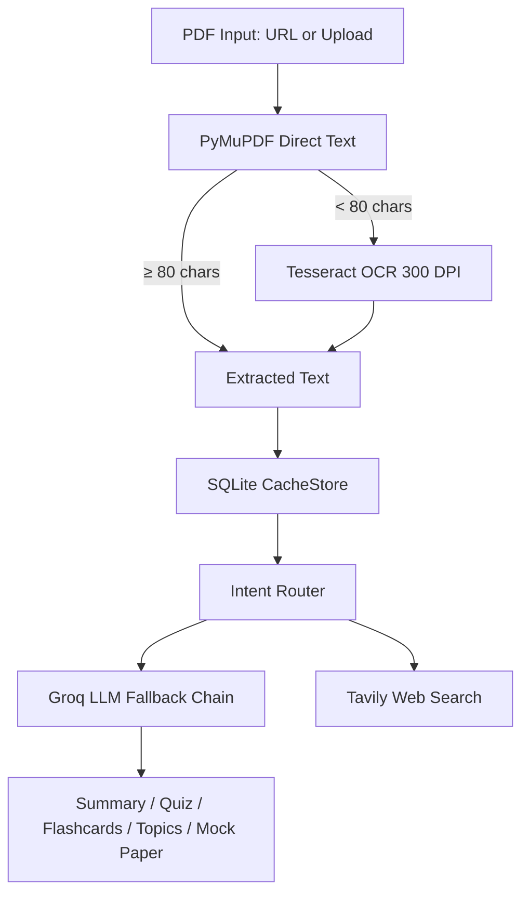

# 🧠 Campus Brain — PYQ AI Study Assistant

Campus Brain is an AI-powered study assistant for university Previous Year Question (PYQ) papers that converts raw exam PDFs into interactive revision materials. It can be used in two ways:
1. **Embedded in a PYQ website** via an `<iframe>` receiving paper parameters in the query string.
2. **Standalone web app** with direct drag-and-drop PDF upload on the landing page.

---

## ✨ Features

- **Smart PDF Ingestion**: PyMuPDF direct text extraction with fallback to local Tesseract OCR (with preprocessing) for scanned pages.
- **Subject Detection**: Automatic header and curriculum matching to identify subject and semester.
- **Study Aids**: Instant paper summaries, interactive 5-question MCQ quizzes, and flashcards.
- **Topic Heatmap & Top 5**: AI-tagged topics (saved once per paper), frequency heatmaps, and Top 5 recurring exam topics with marks and past questions.
- **Exam Predictor**: Heuristic analysis calculating topic probability scores and identifying repeated questions across years.
- **Mock Paper Generator**: Builds balanced practice papers weighted by topic frequency, with printable PDF export.
- **Answer Checker & Web Q&A**: Evaluates student answers with marking schemes; answers syllabus questions with optional Tavily web search.
- **Safety & Guardrails**: Off-topic prompt detection, SSRF-safe PDF URL fetching, prompt-injection shielding, and shared Groq rate-limit tracking.
- **Caching**: Local SQLite caching for extracted text, LLM outputs, and topic tags so duplicate calls are avoided.

---

## 🛡️ Protecting Free API Quota

To operate reliably within free API tiers:
1. **Lazy Once-Per-Paper Tagging**: Question topics are tagged on demand and permanently cached in SQLite.
2. **Inherited Topics**: Identical questions across paper years inherit existing topic tags without calling the LLM.
3. **Cheaper Tagging Model**: Topic tagging defaults to `TAGGING_MODEL` (`openai/gpt-oss-20b`).
4. **Daily Budget & Batch Limits**: `TAGGING_DAILY_BUDGET` caps daily tagging calls; `TAG_MAX_PER_CLICK` limits batch tagging per action.
5. **Pre-call Quota Checks**: `quota_ok()` aborts background requests before making Groq calls if rate limits are exhausted.
6. **No Poisoned Cache**: Unsuccessful or fallback responses are never stored in the database.
7. **Session Limits**: `MAX_PROMPTS_PER_SESSION` applies a soft prompt counter per student session.

---

## 🏗️ Architecture



```
campus-brain/
├── app.py                     # Main Streamlit app entrypoint
├── packages.txt               # OS packages for Streamlit Cloud (tesseract-ocr)
├── requirements.txt           # Python dependencies
├── components/                # UI widgets (action buttons, chat box, theme, meter)
├── data/                      # Curriculum subject mappings
├── generation/                # LLM & heuristic generation modules
├── ingestion/                 # PDF extraction, OCR, validation, safe fetching
├── retrieval/                 # SQLite-backed paper and subject lookups
├── router/                    # Chat intent routing
├── services/                  # Groq client with fallback chain and Tavily search
├── storage/                   # SQLite cache store
├── tests/                     # Automated pytest suite
└── tools/                     # Maintenance utilities
```

---

## 🔗 URL Contract

When embedding Campus Brain in a PYQ website via iframe:
- **`paperId`** *(required)*: Unique identifier for the paper.
- **`pdfUrl`** *(required)*: Public URL to download the PDF.
- **`subject`** *(optional)*: Subject name (e.g. `Operating Systems`).
- **`year`** *(optional)*: Exam year (e.g. `2023`).
- **`branch`** *(optional)*: Engineering branch (e.g. `CSE`).
- **`semester`** *(optional)*: Semester number (e.g. `5`).

```html
<iframe
  src="https://campusbrain.streamlit.app/?paperId=cs501_2023&pdfUrl=https://example.com/cs501.pdf&subject=Operating%20Systems&year=2023"
  width="100%"
  height="850"
  frameborder="0">
</iframe>
```

> ⚠️ **WARNING**: Do NOT rename any URL parameter keys (`paperId`, `pdfUrl`, `subject`, `year`, `branch`, `semester`). Embedding host sites rely strictly on this parameter contract.

---

## 🚀 Setup & Installation

### 1. Clone & Dependencies
```bash
git clone https://github.com/dummycodertech/CampusBrain_chatbot.git
cd pyq-assistant
python -m venv venv
source venv/bin/activate  # Windows: venv\Scripts\activate
pip install -r requirements.txt
```

### 2. Install Tesseract OCR
- **Windows**: Install via [UB-Mannheim Tesseract installer](https://github.com/UB-Mannheim/tesseract/wiki) and add install directory to system `PATH`.
- **macOS**: `brew install tesseract`
- **Ubuntu/Debian**: `sudo apt-get install -y tesseract-ocr tesseract-ocr-eng`

### 3. Configure Secrets
Create `.env` (or `.streamlit/secrets.toml` from `.streamlit/secrets.toml.example`):
```bash
cp .streamlit/secrets.toml.example .env
```
Fill in your `GROQ_API_KEY`.

### 4. Run Locally & Test
```bash
streamlit run app.py
pytest -q
```

---

## ⚙️ Environment Variables

| Variable | Default | Description |
|---|---|---|
| `GROQ_API_KEY` | *(required)* | Groq API key for LLM generation |
| `TAVILY_API_KEY` | `""` | Optional Tavily key for live web search |
| `TAVILY_DEPTH` | `"basic"` | Search depth: `"basic"` or `"advanced"` |
| `MAX_PROMPTS_PER_SESSION` | `"25"` | Soft prompt limit per session |
| `ALLOWED_PDF_HOSTS` | `""` | Comma-separated allowed hostnames for `pdfUrl` |
| `GROQ_MODEL_CHAIN` | `""` | Fallback models (default: `openai/gpt-oss-120b,openai/gpt-oss-20b`) |
| `TAGGING_MODEL` | `"openai/gpt-oss-20b"` | Groq model used for topic tagging questions |
| `TAGGING_DAILY_BUDGET` | `"40"` | Max question-tagging calls allowed per calendar day |
| `TAG_MAX_PER_CLICK` | `"3"` | Max untagged papers processed per click |

---

## ☁️ Deploying to Streamlit Community Cloud

1. Push code to GitHub.
2. In Streamlit Cloud, create an app pointing to `app.py`.
3. Under **Advanced settings**, ensure Python version is 3.10+.
4. Paste secrets into the **Secrets** modal formatted as TOML with quoted string values (refer to `.streamlit/secrets.toml.example`).
5. Verify deployment in Cloud logs by checking for `[app]` startup status lines:
   - `[app] Tesseract binary: found`
   - `[app] Active Groq model chain: ...`
   - `[app] GROQ_API_KEY set: yes`
   - `[app] Storage: local SQLite (cleared on redeploy/restart)`

---

## ⚠️ Known Limitations

- **Local Storage**: `storage/cache.db` resides on local disk and is cleared upon restart or redeployment on Streamlit Cloud, requiring re-ingestion of papers on cold runs.
- **Soft Session Limit**: The prompt count cap resets if the user refreshes their browser.
- **Shared Quota**: Groq rate limits are shared among all active users on the deployed instance.
- **Scanned PDF Processing**: Image preprocessing and OCR on multi-page scanned papers takes noticeably longer on initial ingestion and OCR quality varies with scan clarity.
- **Topic & Question Extraction**: Heuristic regex splitting may occasionally segment messy formatting imperfectly, affecting topic breakdown accuracy.
- **Heuristic Predictions & Mock Papers**: Exam predictions and mock papers use statistical topic weighting and require papers from multiple years of the same subject.
- **Iframe Third-Party Cookies**: Direct file uploads inside third-party iframes may fail in browsers that block third-party cookies (URL parameter mode is unaffected).
- **Branch Disambiguation**: Re-uploading an identical PDF hash under a different branch reuses the previously cached entry.
- **Testing Scope**: Only core extraction, caching, and fallback paths covered under `tests/` are verified with automated test suites; heuristic generators are rule-based.
